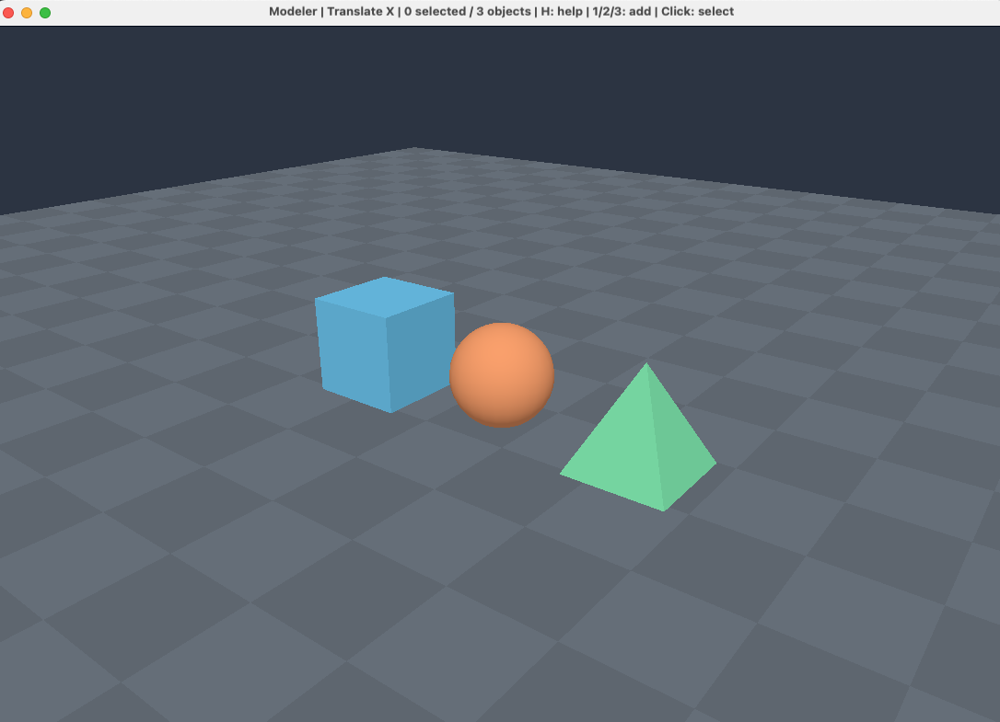

# Rust 3D Modeler

A simple 3D modeller built with Rust, wgpu, and winit.



## Features

- Cubes, spheres, and pyramids
- Camera orbit, pan, and zoom
- Object selection, movement, rotation, and scaling
- Colors, duplication, and grouping
- Undo/redo and JSON save/load

## Run

```sh
cargo run --release
```

## Controls

| Input | Action |
|---|---|
| Left click / Shift+click | Select / multiple selection |
| Right drag / Middle drag / Scroll | Orbit / pan / zoom |
| `1` / `2` / `3` | Add cube / sphere / pyramid |
| `T` / `R` / `S` | Move / rotate / scale mode |
| `X` / `Y` / `Z` | Choose axis |
| Arrow keys | Apply transformation |
| Shift + arrows | Smaller steps |
| `C` / `D` / Delete | Change color / duplicate / delete |
| `G` / `U` | Group / ungroup |
| `A` / Escape | Select all / clear selection |
| `F` / Home | Focus selection / reset camera |
| Ctrl+S / Ctrl+O | Save / load `scene.json` |
| Ctrl+Z / Ctrl+Shift+Z | Undo / redo |

Use **Cmd** instead of **Ctrl** on macOS. Changes are not saved automatically.


